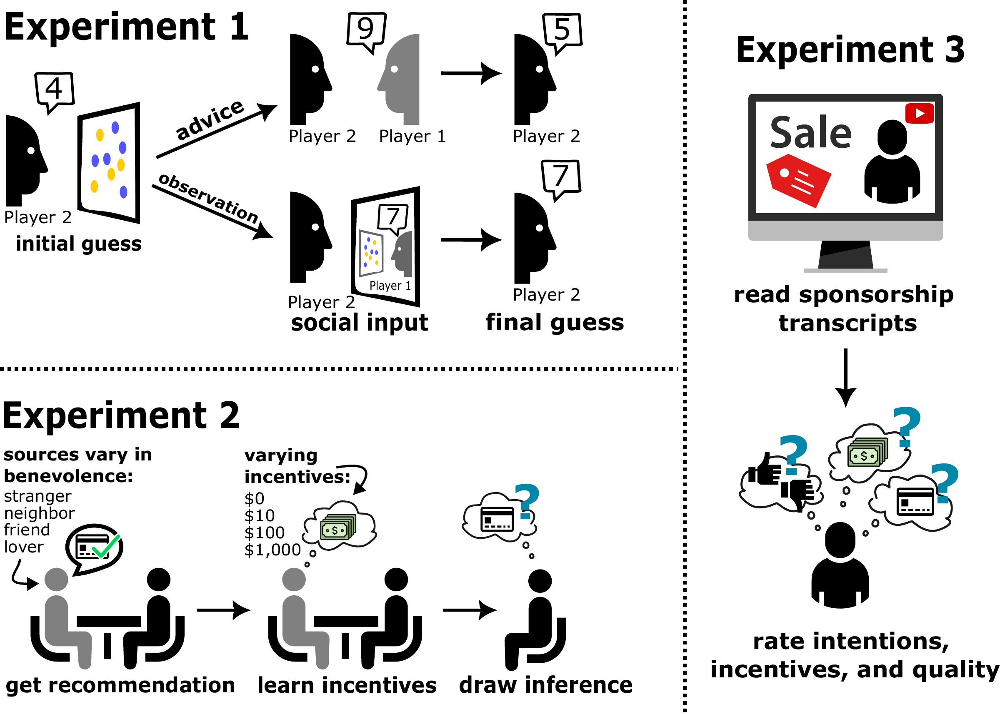

# Are Large Language Models Sensitive to the Motives Behind Communication?

**NeurIPS 2025**

<a href="https://neurips.cc/virtual/2025/poster/115960"></a>
[](https://arxiv.org/abs/2510.19687)

[Addison J. Wu](https://addisonwu05.github.io/)\*, [Ryan Liu](https://theryanl.github.io/)\*, [Kerem Oktar](https://keremoktar.github.io/)\*, [Theodore R. Sumers](https://www.tedsumers.info/), [Thomas L. Griffiths](https://cocosci.princeton.edu/tom/index.php)

\*Equal contribution

&nbsp;&nbsp;


Human communication is motivated: people speak and write with intentions and incentives, so the information LLMs process is framed by them. We test whether LLMs have *motivational vigilance*, the capacity to factor in a source's motives when deciding what to believe. In controlled experiments from cognitive science, LLMs discount information from biased sources in a human-like way that matches rational models of learning from motivated testimony. With sponsored YouTube segments, a more naturalistic setting, their inferences track the rational model much less closely, partly because extra information distracts them; a simple steering prompt that makes intentions and incentives salient substantially restores the correspondence.



---

## Experiments

Each experiment has its own folder with its code, prompts, model settings, data, and a README.

### [Experiment 1](exp1/) — Deliberate vs. incidental information

Watson & Morgan's vigilance game, played by vision LLMs in both roles. Player 2 makes a guess about an image, then sees either Player 1's advice (which need not be honest) or Player 1's actual guess, and may revise. We measure how far Player 2 moves toward each kind of information.

### [Experiment 2](exp2/) — Nuanced vigilance in controlled vignettes

LLMs rate speakers in Oktar et al.'s vignettes (credit card, medicine, real estate): how much each speaker cares about the listener, how much their incentive matters to them, and how good their recommendation is, across 4 relationships × 4 incentive levels. A Bayesian model of motivated communication predicts the last rating from the first two; we compare the LLMs with the model and with human participants.

### [Experiment 3](exp3/) — Vigilance in the wild

LLMs rate real sponsored YouTube segments (from SponsorBlock, with brand names censored) on the same three questions, with and without steering prompts that point them to the speaker's motives.

---

## Setup

**1. Clone and install**

```shell
git clone https://github.com/addisonwu05/LLM-Vigilance
cd LLM-Vigilance
pip install -e ".[collect,dev]"     # or `pip install -e .` to only reproduce the analyses
```

The Bayesian model runs in [WebPPL](https://webppl.org) with `webppl-json` (`npm install -g webppl`, then `npm install webppl-json` inside `~/.webppl`). Experiment 1's statistics need R with `tidyverse rstan tidybayes ggpattern boot HDInterval rmarkdown`.

**2. Add your API keys** (only to collect new responses; every analysis runs from the committed data)

```shell
cp .env.example .env
# then fill in your keys in .env
```

The `.env` file is gitignored — never commit it. The scripts expect these variables:

| Variable | Provider |
|---|---|
| `OPENAI_API_KEY` | OpenAI (GPT-4o in Exp 1 and 3, o1 and o3-mini in Exp 2, transcript censoring) |
| `AZURE_OPENAI_API_KEY`, `AZURE_OPENAI_ENDPOINT` | Azure OpenAI (GPT-4o in Exp 2) |
| `ANTHROPIC_API_KEY` | Anthropic (Claude 3.5 Sonnet) |
| `GEMINI_API_KEY` | Google Gemini (Gemini 2.0 Flash) |
| `TOGETHER_API_KEY` | Together AI (Llama 3.x, Gemma 3, DeepSeek-R1) |
| `YOUTUBE_API_KEY` | YouTube Data API (only to rebuild the Exp 3 video sample) |

---

## Running Experiments

All commands are run from the repository root with `vigilance` (or `python -m common.cli` without installing). Responses are added to the experiment's `data/` folder, and re-running resumes where a run stopped.

```shell
vigilance exp1 collect --model gpt-4o --instructions direct --payoff competitive
vigilance exp2 collect --model claude-3.5-sonnet --all
vigilance exp3 collect --model gpt-4o --steer incentives --perspective user --purpose trust --instructions cot
```

**Key flags:**

| Flag | Description |
|---|---|
| `--instructions` | `direct` (answer only), `cot` (reason first), or `reasoning` (reasoning models, Exp 2) |
| `--perspective` | `first` (the model is the listener) or `user` (it answers for a user) |
| `--purpose` | the rating to collect: `trust`, `reward_quality` or `offer_quality` |
| `--steer` | Exp 3 steering sentence: `none`, `incentives`, `bias` or `gricean` |
| `--all` | Exp 2: every scenario, perspective, rating and answer format for the model |
| `--seed` | makes the order of questions and the scale flips reproducible |

The exact prompts are in each experiment's `prompts.yaml`, and the settings the paper's runs used (token caps, sample sizes, scale flips) in its `models.yaml`.

---

## Analysis

Every table in the paper is rebuilt from the committed data, without API keys:

```shell
vigilance reproduce
Rscript -e "rmarkdown::render('exp1/analysis.Rmd', output_dir = 'exp1/outputs')"   # Exp 1 figures, t-tests, Stan model
```

| Paper result | Command | Output |
|---|---|---|
| Exp 1 influence (humans 0.34 / 0.37; CoT above 60%) | `vigilance exp1 export` | `exp1/outputs/mean_shifts.csv` |
| Exp 1 figures, t-tests, Stan model | `vigilance exp1 export`, then the Rmd | `exp1/outputs/figures/`, `exp1/outputs/analysis.html` |
| Table 1 (Exp 2 model averages) | `vigilance exp2 tables` | `exp2/outputs/table_main.csv` |
| Appendix B: per-condition table | `vigilance exp2 tables` | `exp2/outputs/table_full.csv` |
| Appendix B: intra- vs. cross-character table | `vigilance exp2 tables` | `exp2/outputs/table_alignment.csv` |
| Exp 3 steering table | `vigilance exp3 tables` | `exp3/outputs/table_steering.csv` |
| Exp 3 transcript-length table | `vigilance exp3 tables` | `exp3/outputs/table_length.csv` |
| Appendix C: Gricean / bias steers | `vigilance exp3 tables` | `exp3/outputs/table_additional_steers.csv` |

`pytest` checks the code against the original scripts and every number printed in the paper. [`docs/PROVENANCE.md`](docs/PROVENANCE.md) records what was verified, how the paper's numbers were computed, and the few rows the committed data does not reproduce.

---

## Repository Structure

```
exp1/                        # Experiment 1: vigilance game
  game.py                    # Plays the game with a model (both players)
  export.py, analysis.py     # Results -> Watson & Morgan's format; the shift statistic
  analysis.Rmd               # Figures, t-tests and the Stan model
  stimuli.py                 # How the circle images were generated
  prompts.yaml, models.yaml  # Prompts; models run and their settings
  data/                      # Games, stimuli, human data; reference/ = the original pipeline's outputs

exp2/                        # Experiment 2: Oktar et al. vignettes
  collect.py                 # Simulated subjects (multi-turn dialogues)
  convert.py                 # Ratings -> Bayesian model inputs
  analysis.py, tables.py     # Model fits, 16-cell correlations, the paper's tables
  audit.py                   # Stored scores vs. the ratings replies state
  prompts.yaml, models.yaml
  data/                      # Responses, human cell means, prompt variants, reference/

exp3/                        # Experiment 3: sponsored YouTube segments
  collect.py, convert.py, analysis.py
  dataset.py                 # How the video sample was built (SponsorBlock -> YouTube API -> censoring)
  prompts.yaml, dataset_prompts.yaml, models.yaml
  data/                      # Videos, responses, reference/

common/                      # Shared by all three experiments
  llm.py                     # API clients (OpenAI, Azure, Anthropic, Gemini, Together)
  bayes.py                   # Ratings -> model inputs, posterior table, best fit
  motivated_model.wppl       # The Bayesian model (WebPPL)
  prompting.py               # Question assembly shared by Exp 2 and 3
  config.py, models.yaml     # Paths, YAML loading, model registry
  parsing.py, stats.py, design.py, files.py
  cli.py                     # The `vigilance` command

tests/                       # test_exp1.py, test_exp2.py, test_exp3.py, golden files
docs/PROVENANCE.md           # Verification record and every discrepancy found
```

Each experiment writes its tables and figures to its own `outputs/` folder (gitignored).

---

## Citation

```bibtex
@inproceedings{wu2025llmvigilance,
    title={Are Large Language Models Sensitive to the Motives Behind Communication?},
    author={Addison J. Wu and Ryan Liu and Kerem Oktar and Theodore R. Sumers and Thomas L. Griffiths},
    booktitle={Advances in Neural Information Processing Systems},
    year={2025}
}
```

## Questions

Email Addison (addisonwu@princeton.edu), Ryan (ryanliu@princeton.edu), or Kerem (oktar.research@gmail.com)!
